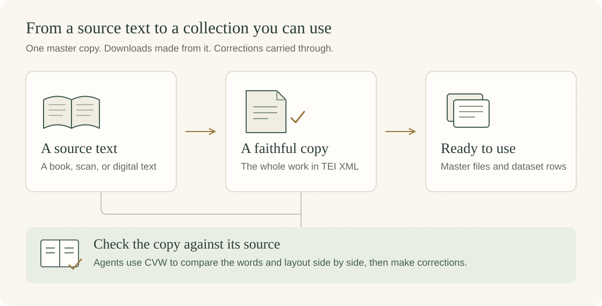

<h1 align="center">Open Christian Data</h1>

<p align="center"><strong>Repository of Christian Texts</strong></p>

[](https://github.com/OpenChristianData/open-christian-data/actions/workflows/ci.yml)

## What is Open Christian Data?

OCD aims to be a single unified collection of publicly available Christian
resources. Our aim is to collate as many high quality Christian works and
resources as are available for distribution into a unified dataset for the
public good. Starting initially with a focus on works of historic significance
in the public domain.

Most public domain Christian literature beyond the Bible is scattered across scanned books, old websites, specialist file formats, and separate digitization projects. Even when a text is online, it may not be available as part of a collection in which its author, work, edition, structure, and source history are clearly preserved. We stand on the shoulders of the faithful saints who have come before to build on their work and stay true to their ethos that information about Christianity and historical Christian texts should be freely and widely available to all. Many of those who have come before, we believe, forged their work in this spirit and dreamed of a project like this one day existing, and we hope to honor and carry on those dreams. We believe advances in AI have made this project possible on a scale that has never been possible before.

The project began as a dataset for AI use, which you can find [on Hugging Face](https://huggingface.co/datasets/OpenChristianDataOrg/open-christian-data). That remains a primary goal. Building it raised three questions that led to a larger project:

1. How do you verify that the text is a faithful copy of its source?
2. How do you verify that the text is a faithful copy of the original published work? The words matter, and so do the structure and formatting. Both help a serious reader understand the text.
3. Is the text usable for AI? Given the changing legal landscape, we decided
   it is essential to maintain proper acknowledgment and a chain of provenance
   with respect to copyright for all texts, while leaving decisions around
   copyright for any use of the data in the hands of the user. The project
   records the rights status of the work, edition, transcription, and source
   layer.

## v1.0.0 — The De-slop release

We've rebuilt the pipeline from the ground up and reprocessed every work in this release, making substantial corrections along the way. We did this so you can have much more confidence in the data you download.

The release brings together **852 works in 881 copies, containing more than 153 million words**. The [collection catalogue](docs/WORK_CATALOG.md) lists every work, with authors, publication details, sources, and reuse terms.

[Download the TEI master copies](https://github.com/OpenChristianData/open-christian-data/releases/download/v1.0.0/open-christian-data-v1.0.0-tei.zip) or use the [13 category downloads on Hugging Face](https://huggingface.co/datasets/OpenChristianDataOrg/open-christian-data/tree/v1.0.0). See the [release notes](docs/releases/v1.0.0.md) for the changes and download details.

## How the collection is made

We start with a particular text and carefully make a faithful copy. We keep that copy in TEI, an XML format for books and other texts. It can hold the whole work, including headings, paragraphs, verse, notes, and references.

Our [Corpus Verification Workbench (CVW)](cvw_app/README.md) lets agents compare a copy with its source side by side, so they can check the words and layout and correct their work.

The dataset downloads are built from the master copies. When we correct a copy, we rebuild its downloads too.



For a visual tour of the programs and workflow, open [the project guide](docs/PROJECT_GUIDE.html) in a browser. Point at a box for a short explanation.

## Get the texts

| What you want | Where to find it |
|---|---|
| Browse the works and editions | [Collection catalogue](docs/WORK_CATALOG.md) |
| Whole texts in TEI XML | [TEI master copies ZIP](https://github.com/OpenChristianData/open-christian-data/releases/download/v1.0.0/open-christian-data-v1.0.0-tei.zip), with a separate file for every edition |
| Text records for training, search, or analysis | [Hugging Face dataset](https://huggingface.co/datasets/OpenChristianDataOrg/open-christian-data) — JSONL downloads and typed Arrow files |
| A bibliography to use in other tools | [CSV](docs/WORK_CATALOG.csv) or [MODS XML](docs/WORK_CATALOG.mods.xml) |
| Source credits and reuse terms | [Source notices](docs/SOURCE_NOTICES.md) |

The collection includes books, Bible translations, commentaries, sermons, creeds, catechisms, prayers, hymns, poetry, dictionaries, and other Christian writing. A work can itself be a collection of sermons, letters, or hymns.

### Load the dataset

```python
from datasets import load_dataset

texts = load_dataset(
    "OpenChristianDataOrg/open-christian-data",
    name="prose",
    split="train",
    revision="v1.0.0",
    streaming=True,
)
print(next(iter(texts))["text"])
```

JSONL files contain one record per line. Depending on the category, a record can be a Bible verse, a passage, a hymn, a question and answer, or a reference entry. Each record includes the work and edition IDs used in the catalogue. Hugging Face loading uses typed Arrow files to keep the text values intact.

**Updating from an earlier release?** Category names and fields have changed. Follow the [migration guide](https://huggingface.co/datasets/OpenChristianDataOrg/open-christian-data/blob/v1.0.0/releases/v1.0.0-migration.md).

## Contributing

We'd love to collaborate with people who want to work on the project. Help us add texts, check copies against their sources, improve the catalogue, or develop the tools. We'd also like to hear your ideas and what you're building with the collection.

Start with [CONTRIBUTING.md](CONTRIBUTING.md), look through the [acquisition and research list](docs/ACQUISITIONS.md), or [open an issue](https://github.com/OpenChristianData/open-christian-data/issues). You can also reach us at [openchristiandata@gmail.com](mailto:openchristiandata@gmail.com).

## Tools and formats

The [text contribution guide](docs/TEXT_CONTRIBUTIONS.md) explains how to prepare and check a text with the project's tools. The [Corpus Verification Workbench](cvw_app/README.md) provides visual comparison. See [CONTRIBUTING.md](CONTRIBUTING.md) for software setup and a small test you can run.

```text
build/         source parsers, reconstruction and release tools
ocd_kernel/    shared text, metadata, validation and release code
cvw_app/       visual verification workbench
schemas/       data and document contracts
tests/         tests and small example collections
docs/          guides, catalogue and source notices
sources/       source descriptions and credits
data/          older JSON files retained for existing users
```

The v1.0.0 TEI masters are supplied as a release download. The older JSON files under `data/` use the previous format; use the versioned downloads above for v1.0.0.

### Schema

The [schemas](schemas/v2/) describe what software can expect in each kind of record. A Bible verse, a hymn and a reference entry need different fields. Work and edition IDs connect those records to the catalogue. Scripture references use OSIS labels such as `Gen.1.1` and `Rom.9.1-Rom.9.5`.


<details>
<summary>Older JSON examples and parser commands</summary>

The following examples work with the older repository data.

The following example reads retained legacy JSON. For current offline releases,
use the generated release card and [reader instructions](docs/LIBRARY_CONSUMER_CUTOVER.md).

```python
import json

with open("data/commentaries/matthew-henry/ezekiel.json", encoding="utf-8") as f:
    resource = json.load(f)

# All entries for Ezekiel chapter 37
ch37 = [e for e in resource["data"] if e["chapter"] == 37]

# All entries for a specific verse range
valley = [e for e in resource["data"] if "37" in e["verse_range_osis"]]
```

## Running the pipeline

Current library browsing and selected offline release assembly use:

```bash
py -3 build/tools/report_library.py
py -3 build/scripts/export_huggingface.py --root <root> --selection <original-selection.json> --output <fresh-release-directory>
```

The release assembler requires accepted TEI and sidecars. It does not publish.
The commands below maintain retained legacy data and do not establish current
library or release acceptance:

```bash
# Validate a data file
py -3 -m build.validate data/bible-text/bsb/genesis.json
py -3 -m build.validate data/commentaries/matthew-henry/ezekiel.json
py -3 -m build.validate data/devotionals/spurgeons-morning-evening/morning-evening.json

# Validate everything
py -3 -m build.validate --all

# Generate BSB bible text (all 66 books from local raw/bible_databases/BSB.json)
py -3 build/parsers/bsb_bible_text.py --dry-run
py -3 build/parsers/bsb_bible_text.py

# Process a single book for any commentary
py -3 build/parsers/helloao_commentary.py --commentary matthew-henry --book EZK

# Process all books for a commentary
py -3 build/parsers/helloao_commentary.py --commentary jamieson-fausset-brown --all-books

# Generate Spurgeon's Morning and Evening (downloads CCEL source on first run)
py -3 build/parsers/ccel_devotional.py --dry-run
py -3 build/parsers/ccel_devotional.py

# Download SWORD modules (Barnes, Calvin, Wesley, Daily Light)
py -3 build/scripts/download_sword_modules.py

# Parse SWORD commentary modules (reads raw/sword_modules/)
py -3 build/parsers/sword_commentary.py --module barnes --dry-run
py -3 build/parsers/sword_commentary.py --all

# Parse Daily Light devotional (SWORD rawLD format)
py -3 build/parsers/sword_devotional.py --dry-run
py -3 build/parsers/sword_devotional.py

# Process Church Fathers quotes (reads raw/Commentaries-Database/, all 335+ authors)
py -3 build/parsers/church_fathers.py --author "John Chrysostom" --dry-run
py -3 build/parsers/church_fathers.py --all-authors

# Process Standard Ebooks titles (reads raw/standard_ebooks/, XHTML sources)
py -3 build/parsers/standard_ebooks.py --id john-bunyan_the-pilgrims-progress --dry-run
py -3 build/parsers/standard_ebooks.py --all

# Generate BCP 1662 Collects (downloads eskimo.com HTML on first run)
py -3 build/parsers/bcp1662.py --dry-run
py -3 build/parsers/bcp1662.py

# Generate BCP 1928 collects (downloads 100 HTML pages from episcopalnet.org on first run)
py -3 build/parsers/bcp1928.py --dry-run
py -3 build/parsers/bcp1928.py

# Generate Didache prayers (downloads Wikisource wikitext on first run)
py -3 build/parsers/didache.py --dry-run
py -3 build/parsers/didache.py

# Process Bible dictionaries (reads raw/bible_dictionaries/*.jsonl)
py -3 build/parsers/bible_dictionaries.py --dictionary eastons --dry-run
py -3 build/parsers/bible_dictionaries.py --all

# Download Project Gutenberg texts (Luther, Baltimore Catechisms, Calvin, Augustine)
py -3 build/scripts/download_gutenberg.py --dry-run
py -3 build/scripts/download_gutenberg.py

# Parse PG catechisms (reads raw/gutenberg/)
py -3 build/parsers/gutenberg_catechisms.py --dry-run
py -3 build/parsers/gutenberg_catechisms.py

# Parse PG theology works (reads raw/gutenberg/)
py -3 build/parsers/gutenberg_theology.py --dry-run
py -3 build/parsers/gutenberg_theology.py

# Parse Nave's Topical Bible (reads raw/sword_modules/Nave.zip)
py -3 build/parsers/naves_topical.py --dry-run
py -3 build/parsers/naves_topical.py
```

Requires Python 3.11 or newer; CI runs 3.12. Install dependencies with `pip install -r requirements.txt`.

Most parsers and `build/validate.py` need only the standard library. The extra dependencies are narrow: `jsonschema` for schema validation, `beautifulsoup4` for the HTML sources, `pymupdf4llm` for the PDF sources, and `datasets` with `huggingface_hub` for publishing to Hugging Face.

### Older schema details

Normalized scripture references use OSIS format (`Gen.1.1`,
`Rom.9.1-Rom.9.5`); current rows also preserve printed labels and unsupported
explicit targets. `schemas/types.ts` describes the retained legacy types.

The current offline library pipeline uses `schemas/v2/` for work, acquisition, acceptance, and public category contracts. Its rows derive from accepted TEI and validated sidecars; see the [pipeline specification](docs/OCD_LIBRARY_PIPELINE_SPEC.md). Existing `schemas/v1/` and `ocd_kernel/schemas/v1/` definitions remain available for historical dataset and source-review contracts. For those contracts, resolve schemas by name with `resolve_schema_path()` from `ocd_kernel.lib.schema_enums` and use generated enum values. The [legacy schema reference](docs/SCHEMA_SPEC.md) describes fields such as `tradition`, `era`, and `audience`; their presence there does not include them in the new public model.

### Historical summary fields

Retained legacy entries may have empty `summary` and `key_quote` fields with
`summary_review_status: "withheld"`. These historical fields do not belong to
the current v2 public model and do not imply a planned enrichment stage.

</details>

## Sources

The collection depends on the work of libraries, archives, digitization
projects, editors, and software communities. Principal sources include CCEL,
Internet Archive, Project Gutenberg, Standard Ebooks, CrossWire, HelloAO,
Hymnary.org, HistoricalChristianFaith, Scrollmapper, Berean Bible, The Kingdom
Collective, New Advent, Wikisource, and specialist source sites.

The hymn collection was provided by [Hymnary.org](https://hymnary.org/) at
Calvin University. If you build with it, please link to Hymnary.org and tell
them about your project through [their contact page](https://hymnary.org/contact).
Many books and other texts were **sourced via
[CCEL.org](https://www.ccel.org/)**.

The [source notices](docs/SOURCE_NOTICES.md) give the credits and reuse terms for every copy in v1.0.0. The [historical source and acknowledgment ledger](docs/SOURCES.md) covers the earlier collection. See [Third-Party Notices](THIRD_PARTY_NOTICES.md) and the [licensing policy](docs/LICENSING.md) for additional detail.

## License

The texts have their own reuse terms. See each record's `license`, the [source notices](docs/SOURCE_NOTICES.md), and the [data terms](docs/DATA_TERMS.md). Public-domain status, CC0, the Unlicense, CC BY, and CC BY-SA remain distinct where they apply.

The project's code, schemas, and tooling are licensed under [CC BY-NC 4.0](LICENSE). For commercial licensing of the software, contact [openchristiandata@gmail.com](mailto:openchristiandata@gmail.com).
