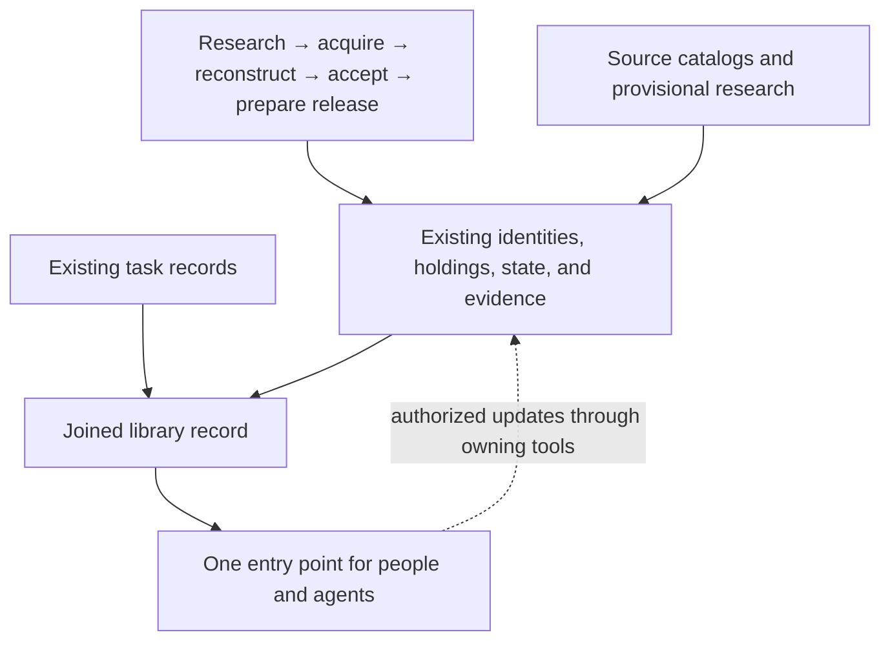

# Connected library records — specification

**Status:** Design reference for the maintained connected-record lookup. Use the
[lookup guide](LIBRARY_RECORD_LOOKUP.md) for current commands and limitations,
and the [pipeline specification](OCD_LIBRARY_PIPELINE_SPEC.md) for authority.
This design does not grant permission to change records or publish.

## Problem Statement

People and agents need to find the complete record of a Christian work:
what it is, what OCD holds, what research exists, what the project intends to do,
and who is doing it. The intended pipeline already records most of those facts,
but its separate interfaces and research records make that picture difficult to
assemble. Historical inventory prose can be mistaken for current holdings;
source-catalog recommendations can be mistaken for acquisition-ready works;
similar titles can hide different translations, editions, or partial holdings.

The TFR investigation demonstrates this gap. Its complete catalog and reviewed
comparisons are retained, and nine subsequent source leads are recorded. The
structured manifest lead queue currently has stale evidence bindings, and its
historical-section importer does not include those nine additions. Research
exists but does not reliably appear in the generated library views.

The problem is record integration across the finished pipeline, extending beyond
acquisition. Replacing the existing authority chain would create unnecessary
reconciliation and threaten the simplification already chosen in the redesign.

## Solution

Provide one library-record lookup for people and agents, built on the existing
joined library views and explicit links to their owning records. Keep one
authoritative home for each fact. A person may receive a readable report and an
agent a structured result, both expressing the same evidence and uncertainty.

The pipeline continues to research, acquire, reconstruct, check, accept,
project, and prepare a selected release. Its records remain connected throughout
that journey. The lookup makes their relationships usable and identifies the
correct tool or record for an authorized update.

The first increment repairs the research connection and delivers a read-only
lookup with update-route guidance. It adds explicit research and task links where
needed; it does not implement a new workflow engine. Catalog, holdings, research,
selection intent, and coordination are functions of the connected record.

### Bounded first increment

- Reconcile every existing structured manifest lead, preserving resolved
  relationships and dispositions, and account for all nine TFR additions.
- Support lookup of declared library works and their declared forms, editions,
  and acquisitions, plus unresolved research leads.
- Support exact lookup of entries in the retained TFR catalog without promoting
  the entire catalog to canonical works or acquisition intent.
- Surface existing reviewed TFR relationships, metadata evidence, and explicitly
  associated active tasks with their actual scope and freshness.
- Produce a versioned structured result and equivalent readable rendering.
- Make missing, invalid, stale, conflicting, or unavailable inputs visible.

All current declared library identities are eligible for work lookup, including
identity-only and OCR-routed works. This does not authorize OCR runtime work or
change any corpus campaign's denominator. The real research-repair batch is the
existing queue plus the nine named additions, not the entire TFR catalog. Capture
the exact input membership and hashes when implementation begins.

## User Stories

1. As a curator, I want one lookup for a work, so that I can see its connected record without assembling several documents.
2. As an agent, I want the same result in a structured format, so that I can act on explicit facts rather than interpret status prose.
3. As a curator, I want to distinguish a work, textual form, edition, and acquisition, so that different copies and translations remain identifiable.
4. As a researcher, I want original source-catalog titles and identifiers preserved, so that I can trace recommendations to their source.
5. As a curator, I want catalog entries to remain visible before they have canonical identities, so that research is not lost or prematurely adopted.
6. As a researcher, I want candidate matches distinguished from reviewed relationships, so that title similarity does not become identity evidence.
7. As a curator, I want rejected matches retained with their reasons, so that future agents do not repeat unsupported merges.
8. As a curator, I want partial-component relationships distinguished from complete-work coverage, so that an excerpt is not reported as a full holding.
9. As a researcher, I want translators, editions, imprints, dates, and production disclosures shown with their evidence where available, so that I can choose the correct witness.
10. As a researcher, I want translation-production status to remain unknown when evidence is missing, so that absent machine-translation disclosure is not treated as proof of human translation.
11. As a curator, I want holdings linked to exact retained files and acquisition receipts, so that I can identify the copy actually possessed.
12. As an agent, I want source extent and completeness claims shown at their verified scope, so that I do not reacquire or process the wrong material.
13. As a curator, I want acquisition, reconstruction, acceptance, review, rights, and publication facts shown separately, so that progress in one area does not imply progress in another.
14. As a curator, I want identity-only works returned without invented editions, so that an intended work can exist before a usable source is found.
15. As a curator, I want OCR-routed works discoverable with their routing, so that the library record remains complete across repository boundaries.
16. As a researcher, I want provisional observations and adopted metadata clearly distinguished, so that research does not silently change canonical bibliography.
17. As a researcher, I want uncertainty and conflicting evidence visible, so that unresolved fields do not acquire guessed values.
18. As an agent, I want stale evidence flagged, so that I do not rely on a dated comparison as a current holding check.
19. As a curator, I want research leads with their intent and disposition retained, so that updating a document does not reset decisions.
20. As a curator, I want new manifest sections accounted for, so that their leads do not disappear because of heading-specific import rules.
21. As a curator, I want complete source-catalog inventory separated from selected acquisition intent, so that respecting TFR's recommendations does not automatically put every entry into an execution batch.
22. As a curator, I want acquisition and improvement views derived from the connected records, so that I do not maintain separate copies of identities and holdings.
23. As an agent, I want a task's explicit work, edition, acquisition, lead, or catalog-entry references, so that I can find the appropriate scope of work.
24. As a contributor, I want active task owners and dependencies shown from their owning tracker, so that I can coordinate before starting overlapping work.
25. As an agent, I want unknown ownership distinguished from no active task found, so that missing coverage is not interpreted as permission to proceed.
26. As an agent, I want the correct update route and its prerequisites shown, so that changes use the existing validation and recovery contracts.
27. As a curator, I want lookup to leave source and authority bytes unchanged, so that inspecting a record cannot advance its state.
28. As a maintainer, I want reproducible results from the same bound inputs, so that generated views can be checked and regenerated.
29. As a curator, I want unreadable or malformed records named in the result, so that visibility failures do not become absence claims.
30. As a maintainer, I want explicit population and coverage information, so that a bounded lookup is not presented as a whole-library holdings audit.
31. As a contributor, I want the record discoverable in the existing checkout, so that I can use it without a new hosted service.
32. As a project owner, I want priorities and publication choices left explicit, so that a diagnostic queue does not silently decide what matters or what to publish.
33. As a maintainer, I want the completed redesign's direct accepted-master release route preserved, so that the lookup does not become a required catalog gate between text and release.
34. As a future collaborator, I want task links that can later accommodate another tracker, so that the first local interface does not force an external collaboration architecture now.

## Implementation Decisions

### 1. Authority and design boundary

The governing pipeline's work → textual form → edition → acquisition model and
accepted TEI text authority are retained. Existing source, acceptance, metadata,
assessment, review, and publication contracts retain their owners. Generated
views remain disposable projections, except for the existing tracked corpus
snapshot's established durability requirement. The lookup owns no independent
identity, text, acceptance, rights, or task-status authority.

The integration evolves the pipeline's intended final shape. It cannot add an
authored catalog between accepted masters and release assembly, infer human
review, or enlarge an active campaign's scope.

### 2. One high-level read interface

Extend the existing joined-view capability rather than introduce a parallel
inventory engine. The supported user interface is a local command that accepts
an explicit identifier selector and returns structured output or readable text.
A reusable read API backs that command. Existing consumers remain supported;
adoption by other surfaces is explicit rather than an automatic cutover.

The selector declares its identity kind and namespace: canonical work, textual
form, edition, acquisition, research lead, or source-catalog entry. A child
selector supplies its required parent identities. Display labels are never
implicit identifiers. Search/ranking is not needed for the first increment;
callers can use existing discovery reports to obtain identifiers.

### 3. Result contract

The versioned result contains the requested selector, resolution outcome,
population/coverage description, bound input references, identity hierarchy,
holdings, research and metadata references, selection intent, task links,
diagnostics, and supported update routes. Empty sections are distinguishable
from sections that were not inspected or could not be read.

Resolution outcomes distinguish found, not found within the declared population,
ambiguous, and invalid request. Section evidence health distinguishes valid,
stale, invalid, unavailable, and not assessed. A partial result remains inspectable
but is never labeled complete for the requested scope. Each section states its
inspection basis as defined below; `valid` always describes that named basis,
never unperformed integrity or historical verification. Overall collection
outcomes distinguish complete for the declared scope, partial, and unstable.

The command exits with success only for a resolved selector and a complete result
at the declared default inspection level. A not-found result exits separately
from invalid request, ambiguity, stale/invalid required input, incomplete required
coverage, unreadable required input, and unstable collection. Those latter cases
return a diagnostic failure status while preserving any usable partial result.
The serialized result retains the precise cause even where several causes share
a non-success exit code. An explicit unknown bibliography or an intentionally
historical observation is valid research, not a collection failure. Unperformed
deep checks outside the declared inspection level also do not make collection
fail; they remain visibly unassessed.

Readable and structured outputs use the same normalized result. The result does
not copy full source catalogs or text bodies. It returns relevant observations,
references, and the requested record's connected scope.

### 4. Fact ownership

| Fact | Authoritative owner |
|---|---|
| Canonical work/form/edition identity | Validated stable identity sidecar |
| Current acquisition/edition stage | Validated mutable state sidecar |
| Exact retained source and access/rights observations | Acquisition record and bound source evidence |
| Complete accepted wording and detailed edition header | Accepted TEI master and acceptance evidence |
| Source-catalog assertions | Retained source-catalog observation at a named revision |
| Provisional research and source choices | Owning research record and its evidence |
| Lead intent, disposition, and resolution | Structured research lead; historical source prose remains evidence |
| Current collection intent for a known work/target | Applicable current campaign worklist or explicit collection decision; outside its scope, not recorded |
| Diagnostic acquisition/improvement issues | Generated evidence views; issues are not pursuit decisions |
| Reviewed cross-record relationship | Evidence-bound research relationship record |
| Metadata requirement, adoption, and inspection | Existing authored metadata decisions and their generated evidence views |
| Task owner, status, and dependencies | Existing owning task tracker |
| Public release selection and publication | Existing release selection/action authority |

A repeated fact in an output is a labeled projection with its owner reference.
When owners disagree, the result exposes the disagreement instead of picking a
convenient date, title, or status. Historical prose does not override current
validated holdings or lifecycle records.

Selection is returned as separate facts: historical lead intent, current
acquire/improve/hold-or-defer decision and its target scope, current campaign
membership/disposition, diagnostic issues, and release selection. Each names its
owner and applicability. A campaign's fixed membership does not select works
outside that membership. When current applicable collection intent is absent,
report not recorded; when its owner cannot be inspected, report unknown with the
coverage failure. Work existence, accepted state, or a generated queue issue never
creates a new acquire/improve decision. Conflicting current decisions remain
conflicting until resolved in their owning workflow.

### 5. Research identity and repair

A lead's identity survives source-document edits, movement, and regeneration.
Preserve all existing lead identifiers as legacy identities; new additions use
their already assigned stable TFR lead identifiers. Source line numbers and
claim hashes remain locators/evidence, not the identity algorithm for new leads.

Before repair, bind the exact queue membership, dispositions, promoted links,
manifest revision, and nine additions. For each old claim, establish whether it
is unchanged, moved, corrected, removed, or unresolvable. Preserve historical
witness bytes or an exact retained version when current document edits make the
old witness unavailable. Rebind only after exact claim comparison; a changed
claim requires explicit research revision with its previous evidence retained.
Never repair freshness by replacing hashes alone or resetting dispositions.

The importer accounts for every row in declared acquisition-research sections,
including the TFR additions, with imported, already represented, contextual,
ambiguous, or invalid disposition. Manifest headings outside the configured
population are named exclusions, not silently considered imported. Grouped rows
stay grouped until source evidence supports splitting; one row is not one work.
The lead queue owns editorial dispositions; re-extraction owns source observations.
Regeneration merges them by stable identity and reports conflicts.

The repair must explicitly version the lead importer/validator contract that
currently recomputes `manifest-` identifiers from current line positions and
rejects moved legacy IDs. Its reviewed migration map binds old identifier,
old exact witness/claim, new locator or explicit revision, and conserved editorial
fields, including closure reasons and promoted work links. New observations may
be added without recoding the old IDs. Stage the exact bounded repair and retain
its preimages and conservation receipt under existing update/recovery rules;
cutover cannot leave supported consumers reading an incompatible half-migration.

### 6. Catalog inventory and relationship bridge

The retained TFR catalog has its own namespace and snapshot identity. Preserve
provider identifiers where provided. If an identifier is derived locally, label
that fact and bind it to the snapshot; do not present it as a globally stable
provider key. Duplicate source identifiers yield an ambiguity diagnostic.

An observation alone creates neither a canonical work nor acquisition intent.
A canonical work can be established when evidenced identity and real OCD intent
exist, even before any edition or source is established. The catalog's inventory
and the project's selected work population are separately accounted.

Reviewed links have a relationship identity, source-entry/lead reference, target
canonical identity at an explicit work/form/edition/acquisition level, relation
and extent description, decision status, reviewer identity, decision time,
evidence bindings, and unresolved questions. Candidate and rejected links remain
research. Relationship validation checks reference existence, evidence freshness,
and hierarchy consistency; it cannot prove the historical judgment itself.

The initial relation vocabulary covers same work, same textual form, same
edition, same acquisition, partial component, related work, and unresolved
candidate. Decision status is independently proposed, reviewed, or rejected.
The initial structured relationship representation is owned by research and
reuses existing reviewed-crosswalk evidence; it does not store mutable holdings
facts. Legacy TFR descriptions are preserved verbatim during normalization, and
weak or incomplete evidence limits the normalized relationship strength.

Relationship validation enforces the following permitted claims:

| Relationship | Required identity level and meaning |
|---|---|
| Same work | Evidence establishes the intellectual work. It permits no assertion about equivalent wording, edition, extent, retained bytes, or completeness. |
| Same textual form | Target names a declared form under its work; evidence establishes the same translation/revision/abridgment. Matching language alone is insufficient. |
| Same edition | Target names a declared edition under its form/work; evidence establishes that publication witness. Matching year or title alone is insufficient. |
| Same acquisition | Target names the declared acquisition and its parent edition/form/work; evidence establishes the same exact source instance and bounded members/scope, not merely a common work or matching archive filename. |
| Partial component | The link explicitly names which endpoint contains the other, the identified containing work/form, the component boundary, and evidence for that containment and wording scope. It never implies full-work possession or a shared edition. |
| Related work / unresolved candidate | Describes a comparison or possible relationship without identity or containment conclusions. |

These minimum levels are structural requirements plus evidenced judgments, not
automatic historical identification. Stronger same-identity links may expose
their declared parent hierarchy; weak links and transitive traversal cannot
upgrade identity strength or infer coverage/completeness. A reviewed decision
records the judgment at its stated date and scope. Current applicability is
reported independently as supported, superseded, conflicted, or unassessed.
Matching the bytes of a legacy crosswalk proves its preservation, not the
continued correctness of its historical judgment.

In particular, the old TFR `1928-bcp` partial-component comparison is preserved
as dated research. The later English Deposited Book correction prevents adopting
it as current evidence that the American collects are contained in that work.
Until appropriate containment evidence is established, the current lookup shows
that comparison as superseded/conflicted or unresolved, with the correction
linked; it makes no positive containment claim.

### 7. Bibliography and production disclosures

Expose adopted identity/edition metadata and source-attributed observations
separately. Unknown bibliographic values remain absent with uncertainty or source
coverage shown. A source's author attribution, translator attribution, production
disclosure, or rights statement is an observed claim unless separately verified.

English-language content, publication age, and silence about AI do not establish
non-machine translation. Production disclosures must name their source, date,
and whether they apply to the original wording, translation, OCR, transcription,
or later processing. OCR and translation are separate activities. No inferred
clearance or blanket rights class is introduced by this integration.

### 8. Task connections and ownership

Task links are read from supported existing trackers using explicit identities.
Each returned link identifies its tracker, task, subject scope, owner/status as
recorded, explicit dependency references and their resolution health, evidence
revision, and whether it is current or historical. An adapter declares which
tracker populations it examined. Missing owner fields remain unknown;
disagreement between applicable current records is an ownership conflict.

Coordination coverage is separately complete for named declared populations,
incomplete/unsupported, or unavailable. The implementation inventory accounts
for the applicable current owning ledgers identified by project-state routing,
including acquisition and pipeline work. A historical ticket-family adapter alone
cannot establish current ownership coverage. Unsupported applicable sources are
reported rather than silently omitted.

`No active task found` always means none found in the explicitly examined
population; it never means globally unowned or available to start. Current versus
historical status follows the owning anchor/ledger's explicit supersession and
current-section rules. An unchanged hash or a recently edited old ticket does not
make its recorded owner current. A newer supported current-owner record and an
explicitly superseded historical record are not an active ownership conflict.

When a tracker cannot hold an explicit cross-reference, a small connection record
may own the association only. It never duplicates owner, progress, or lifecycle
facts. Record writers must continue to use the owning tracker and pipeline tools.
The first increment has no task leases or enforced distributed claims. Existing
file-write locks remain write coordination, not task assignment.

### 9. Update-route guidance

The first increment's lookup is read-only. For each editable fact, it names the
owning record kind, supported operation/tool, identity scope, required evidence,
and revision or authorization prerequisites already required by that operation.
It must label unsupported operations as requiring owning-workflow work, rather
than offer an arbitrary file edit. It never executes a suggested operation.

Subsequent mutations continue through existing staged validation, before-hash
checks, installation/recovery, metadata adoption, and task-update routes. A future
write interface would require its own bounded contract and evidence; this spec
does not authorize a universal update endpoint or claim a transaction across all
records and retained files.

### 10. Freshness, determinism, and concurrent reads

Normalize identities, ordering, and diagnostics deterministically for identical
bound inputs. A result fingerprint binds the interface, adapter, and normalization
contract versions; exact authority, relationship, and research-record content
identities; relevant discovery membership; and the logical storage routing and
availability/presence observations actually used. Physical machine paths may
appear privately as diagnostics, but cannot silently change logical identity.
Observation time is execution metadata and does not alter the canonical record
payload or input fingerprint.

Read through existing storage-aware and accepted-generation interfaces. Detect
an input change during collection and retry the bounded lookup once; on another
change return an explicit unstable-input result. Before/after checks cover both
consumed records and relevant membership, including new/deleted matching tasks,
links, catalog entries, or lead records. Negative lookup and qualified task-absence
results bind the membership actually examined. Unknown or inaccessible membership
cannot support an absence assertion.

The result does not claim a global atomic snapshot of a concurrently changing
checkout. A pinned Git revision binds only its tracked inputs: external retained
storage, ignored configuration, permissions, and discovery membership may still
change. Repeatability requires the complete input/observation envelope above,
at the stated inspection level; it does not guarantee external-byte integrity
when that check was unperformed. No permanent snapshot service, daemon, watcher,
or global transaction is introduced.

### 11. Default inspection level, bounded work, and output privacy

Default lookup performs request-scoped record validation and current presence
observations, not a retained-byte, source-fidelity, or full acceptance audit. Each
relevant finding distinguishes the following bases in machine and readable output:

- Record syntax, identity/reference consistency, and exact consumed-record digest.
- Declared acquisition facts, including the recorded file hashes and extent.
- Current observed presence/accessibility and size where inspected.
- Previously recorded verification/acceptance, with the exact receipt, date,
  declared input identities, and scope; its current byte applicability is unassessed
  unless actually checked.
- Current byte-integrity verification, only when a separate explicit operation
  has actually performed and bound it; otherwise unassessed.

Record health `valid` cannot upgrade a declared source hash into an observed
current hash, nor turn recorded acceptance into freshly verified master bytes.
If a raw source changes without this default lookup reading it, its integrity
remains unassessed even if its presence and size look unchanged. The default
result does not make a stronger claim. Known stale or inaccessible required
record evidence produces the corresponding health diagnostic and partial/failure
outcome; a preserved historical observation remains readable with its historical
scope and current applicability clearly labeled.

Reuse the existing loaders, validation rules, and normalization through a
request-scoped collector. Wrapping the current full snapshot/browse builder and
filtering afterward does not satisfy this contract: that builder hashes retained
members and masters across unrelated works. Existing whole-library snapshot
generation retains its deeper checks and output semantics. The selected-record
lookup must not weaken those checks or create a second fact authority.

Lookup must not reconstruct texts, download sources, inspect all raw storage,
read unrelated retained sources/masters, or read retained text/master bodies for
the default identity query. Relevant small authority records and bound research
witnesses are inspected; linked heavy evidence is returned with its declared
facts and verification basis. A deeper verification remains an explicit separate
owning-workflow operation. Current presence is not source-fidelity proof.

Internal paths, evidence, assessments, and task records remain private internal
results. Nothing is added to public release envelopes or remote upload inputs.
The interface must honor configured logical-to-physical storage routing and
report inaccessible evidence as unavailable. Name the lookup's coverage so that
historical undeclared retained holdings are not reported absent.

### 12. Schema and compatibility work

New research-link and lookup envelopes require small closed, versioned contracts
with explicit identity and evidence rules. Reuse existing enums and validators
where applicable, and complete required generated-constant checks for any
affected schema. Exact serialized names are implementation details, but the
semantic requirements above are mandatory.

Current callers of the joined-view builder, library browse report, lead validator,
metadata readers, and handoff reports are inventoried before changes. Preserve
their existing output contracts or use an explicit new version and update every
affected supported consumer. Do not force full research enrichment or task
enumeration on an existing fast work-only consumer. Existing historical
comparisons remain dated evidence; they are not rewritten as live authority.

## Testing Decisions

### Primary seam

Robbie confirmed the unified lookup as the main test seam on October 2, 2026.
Test external behavior at the library-record lookup command/read API: selector in,
normalized record and diagnostic outcome out. Test the readable rendering against
that same result. Prefer fixtures using the existing joined library view,
research-lead, metadata, and handoff interfaces. Test implementation helpers only
when a boundary cannot be proved through this seam.

Read-only guidance is part of this seam: an unsupported or unauthorized update
route is visibly unavailable. Existing writer behavior keeps its existing tests;
the new lookup does not need a replacement write harness.

### Required behavior cases

| Case | Observable acceptance condition |
|---|---|
| Known work with multiple forms/editions | Each child retains its identity and independent holdings/state; no title-based merging occurs. |
| Identity-only or OCR-routed work | Work is returned without fabricated editions; routing and coverage are explicit. |
| Unresolved catalog entry | Source observation is returned without creating a work or acquisition intent. |
| Similar titles / prayer-book correction | Feed the actual old partial-component link and later English Deposited Book correction; preserve the historical comparison but reject unsupported current containment. Distinct IDs alone are not sufficient. |
| Relationship strength | Each kind meets its required level; work-only, language-only, year-only, or chained weak evidence cannot produce stronger identity or complete-coverage claims. Partial containment has direction, boundaries, and evidence. |
| Work-level reviewed TFR link | The work connection is shown without claiming identical translation, edition, acquisition, or completeness; a preserved historical decision is not silently adopted as current. |
| Production disclosure missing | Machine-translation status remains unknown; English content or old dates do not imply human translation. |
| Missing, malformed, changed, or unreadable authority | Named section diagnostic and non-success outcome where appropriate; never a clean absence claim. |
| Research repair | Every input lead and all nine additions have a disposition; unchanged IDs, editorial intent, closure reasons, and promoted links are conserved; the versioned importer/validator accepts preserved moved legacy IDs only through an evidenced migration; changed/ambiguous claims require explicit decisions. |
| Source document movement or edit | Stable lead IDs persist, previous evidence remains traceable, and unchecked rebinding is rejected. |
| Historical versus current collection intent | Baxter's historical NEXT/research intent, current applicable campaign disposition, accepted holding, diagnostic issues, and release selection are separate facts; no new pursue decision is inferred. |
| Multiple or unsupported task sources | An owner outside the old 37c population yields explicit incomplete coverage when its current ledger is unsupported; no result asserts global availability. Superseded old owners are historical, current conflicts remain visible, and dependency links/health survive. |
| Concurrent input change | Changed records or new/deleted matching discovery members trigger bounded retry then unstable-input result; no falsely coherent current snapshot or qualified absence. |
| Pinned revision with changed external evidence | The same Git revision with different external availability, storage observations, or discovered tasks does not receive the same complete input fingerprint. Default byte integrity remains unassessed unless checked. |
| Determinism and projections | Same bound inputs produce the same canonical payload, ordering, and fingerprint; readable/machine results agree. |
| Read-only behavior | Lookup and failed lookup leave authoritative records, retained source bytes, masters, task records, and publication selections unchanged. |
| Update-route guidance | The correct owner operation and prerequisites are returned; lookup performs no mutation and cannot bypass acceptance or publication rules. |
| Inspection basis and cost | Deny unrelated raw/master reads and default text/master-body reads at the lookup seam. Changed same-size retained bytes cannot be labeled currently integrity-verified from a valid sidecar or old receipt. Declared, observed-presence, historical-verification, and current-verification facts remain distinct. |
| Compatibility | Existing supported view/report consumers retain their contract and deeper evidence checks; the selected-record collector does not redefine full-snapshot acceptance. |

### Evidence required before implementation completion

1. A reviewed input/consumer inventory names the exact research repair population,
   supported catalog revision, applicable current task/collection-intent trackers
   and their supported/unsupported coverage, and interface/adapter versions.
2. A conservation report accounts for every preexisting lead disposition/link and
   all nine TFR additions, including holds; no ambiguous identity is forced.
3. A bounded real-record walkthrough covers Baxter, the two 1928 prayer-book
   targets including the superseded containment comparison, an unresolved lead,
   an identity-only work, differing historical/current intent, and current,
   historical, unknown, and incomplete task ownership. Synthetic fixtures prove
   invalid relationships, bounded reads, external-input changes, dependencies,
   and concurrent membership cases.
4. Focused tests covering the lookup and changed existing contracts pass; authority
   byte-conservation and generated-view freshness are independently checked where
   changed. Passing lookup tests do not establish corpus fidelity or publication.
5. The readable usage guide names each result's scope, failure meanings, authority
   owners, and update routes. The integration has one canonical specification and
   one current execution tracker.

These are planned acceptance conditions. No tests or library repair are performed
by the present specification-writing task.

## Out of Scope

- Replacing sidecar authority with a database, hosted registry, or alternate text store.
- A new web application, visual-review surface, universal metadata warehouse, or workflow engine.
- Reconstructing or downloading texts, acquiring every TFR work, or auditing the entire catalog item by item.
- Priority scoring, importance rankings, automated work selection, or automatic source choice.
- Distributed leases, automatic agent dispatch, or enforceable task reservation.
- External contributor hosting, account/access design, outreach, or repository publication.
- Changing TEI acceptance, human-review requirements, rights clearance, release profiles, or explicit publication authority.
- Removing legacy consumers or altering live corpus campaign denominators through this integration alone.
- Implementing a universal mutation interface or claiming cross-file/database transactionality.

## Further Notes

### Relationship to the intended redesign

This makes the pipeline's existing promises about known works, evidence, research,
state, and generated views accessible through one coherent interface. It extends
their connections and usability without reviving the expanded WorkCatalog control
plane. The five-function model is an explanation of responsibilities, not five
new services. Product naming remains a later decision.

### References and implementation orientation

Paths appear here as orientation, not as implementation decisions or new owners.

- [Governing pipeline specification](OCD_LIBRARY_PIPELINE_SPEC.md), especially user stories 18–30 and 33, and decisions 3–8 and 16–19.
- [Intended topology](OCD_LIBRARY_PIPELINE_TOPOLOGY.md), especially research leads, authority files, and generated views.
- [Public contribution and maintainer decision route](../CONTRIBUTING.md).
- [Supported library and release commands](LIBRARY_CONSUMER_CUTOVER.md).
- Existing seams: [joined views](../ocd_kernel/library/views.py), [lead handling](../ocd_kernel/library/acquisitions.py), [readable library report](../build/tools/report_library.py), [metadata decisions/evidence](../build/lib/source_metadata.py), [handoff report](../build/tools/report_library_handoffs.py). CVW admission is a separate private operator integration, not a public setup prerequisite.
- Existing behavior tests: [library views](../tests/test_library_views.py), [acquisition leads](../tests/test_acquisition_leads.py), [metadata reports](../tests/test_library_metadata_report.py), [metadata review](../tests/test_source_metadata_review.py), and [handoff reports](../tests/test_report_library_handoffs.py).
- Retained catalog snapshots and reviewed research links are maintainer inputs;
  public proposals can identify a work by title/edition and an exact public source
  locator, without obtaining those private records.

The October 2 map's counts and freshness findings are dated evidence, not a frozen
implementation population. Implementation must inspect current bytes and preserve
parallel ownership before repairing records or generating views.

### Independent review record

The October 2 specification review identified five required findings, addressed
in revision 2 and closed by a bounded rereview. Maintainers retain the dated
review inputs, dispositions and hashes privately. Those receipts are historical
specification evidence, not proof of current runtime or corpus readiness. A
public contributor can use the interfaces above and the contribution route
without access to that private execution history.
